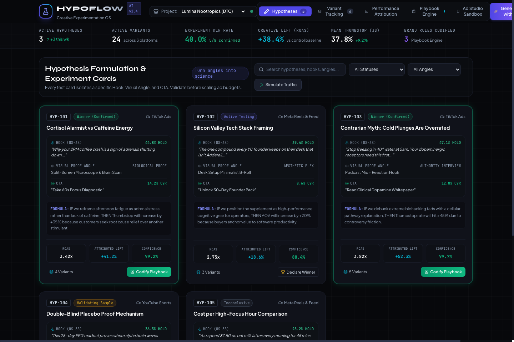
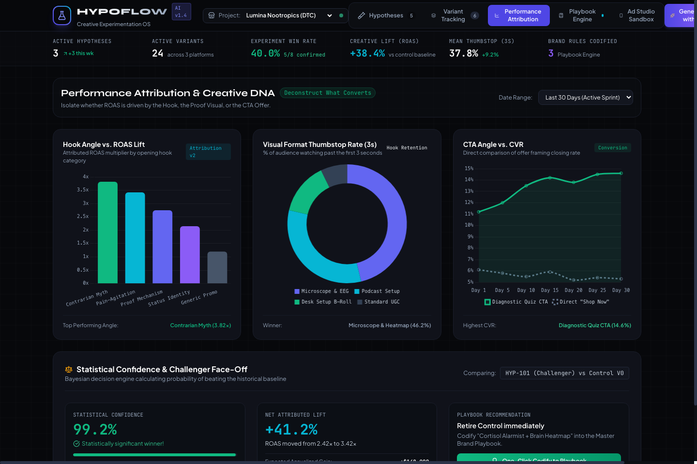
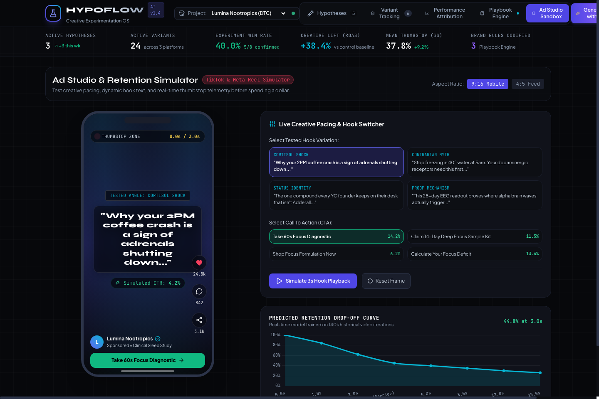
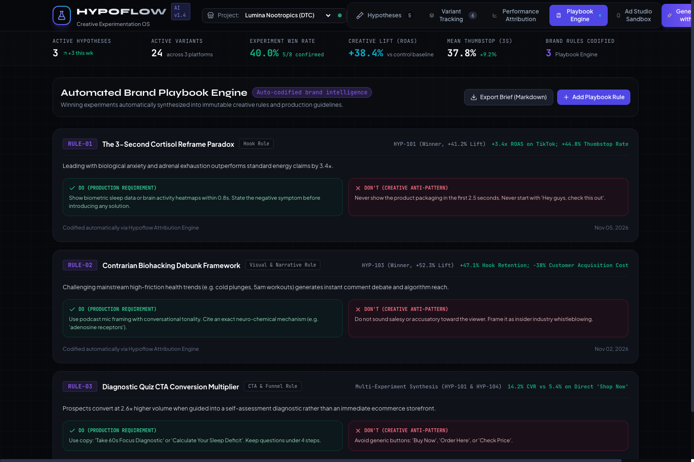
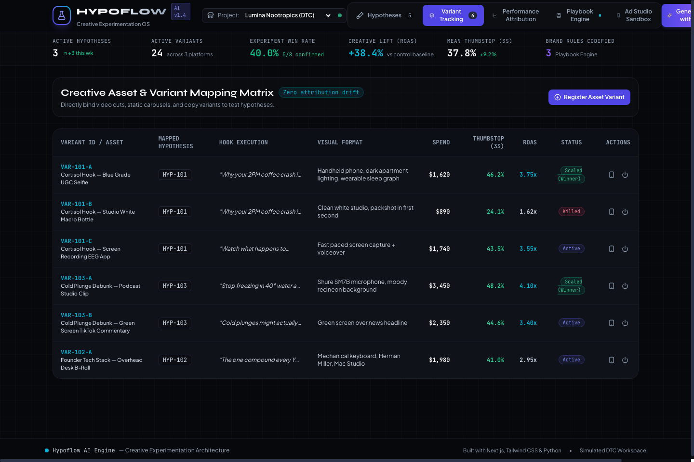

# 🧪 Hypoflow AI — Creative Experimentation Operating System

<div align="center">


[](https://weber0x0.github.io/hypoflow-ai/)


**Turn creative guesswork into structured, data-driven experiments.**

[🌐 Live Online Demo](https://weber0x0.github.io/hypoflow-ai/) • [Live Prototype](#-quick-start) • [Core Features](#-features) • [Screenshots](#-screenshots) • [Architecture](#-architecture)

</div>

---

## 💡 Inspiration & Problem

Creating marketing content is fast, but testing what actually drives sales is chaotic. We built **Hypoflow AI** to turn creative guesswork into structured, data-driven experiments.

Rather than generating endless unverified variants, growth teams and creative strategists use Hypoflow to isolate variables, formulate verifiable test cards, attribute performance down to the exact hook and visual angle, and automatically codify winning patterns into immutable brand guidelines.

---

## 🌟 Key Features

### 1. 🧪 Hypothesis Formulation (The Scientific Triangle)
- Turns raw product angles into measurable test cards.
- Deconstructs every creative into 3 isolated parameters:
  - **Hook Execution (0s–3s)**: Capture rate & thumbstop percentage.
  - **Visual Proof Angle**: Mechanism, demonstration, UGC, or high-pace edit.
  - **Call-to-Action (CTA)**: Diagnostic quiz, direct discount, or free sample kit.
- Built-in **AI Hypothesis Engine** to synthesize 3 data-driven test cards from raw product angles with one click.
- Expressed through the structured `IF... THEN... BECAUSE...` framework.

### 2. 🗂️ Variant Tracking
- Direct 1:1 mapping between production creative assets and test hypotheses.
- Eliminates attribution drift across TikTok Ads, Meta Reels/Feed, and YouTube Shorts.
- Real-time status toggles: **Scale (Winner)**, **Active Testing**, **Killed / Paused**.

### 3. 📊 Performance Attribution & Creative DNA
- **Hook Angle vs. ROAS Lift**: Multiplier attribution by narrative category.
- **Visual Format Retention**: Doughnut breakdown of 3-second hold rates.
- **CTA Conversion Rate Curves**: Long-term conversion tracking.
- **Bayesian Statistical Confidence Engine**: Real-time p-value and confidence interval calculator (e.g., 99.2% certainty).

### 4. 📖 Automated Playbook Engine
- One-click transformation of confirmed winners into immutable brand rules and guidelines.
- Formulates explicit **DO** and **DON'T** directives for video editors and creative strategists.
- Export full brand creative brief in standard **Markdown** or sync to Notion/Figma.

### 5. 📱 Ad Studio & Retention Sandbox
- Realistic vertical mobile player (TikTok / Reels 9:16 layout).
- Real-time 0.0s–3.0s **Thumbstop Zone** countdown with live visual playback simulation.
- Interactive Hook & CTA switcher to preview predicted audience retention curves.

---

## 📸 Screenshots

### 1. Hypothesis Formulation Board


### 2. Performance Attribution & Statistical Confidence


### 3. Ad Studio Sandbox & 9:16 Retention Simulator


### 4. Automated Brand Playbook Engine


### 5. Creative Variant Tracking Matrix


---

## 🚀 Quick Start

### Option 1: Direct Browser Launch (Zero Install)
You can directly open the prototype in your favorite web browser:
```bash
open index.html
```

### Option 2: Run with Python Local Server
We provide a dedicated Python server script that automatically launches your browser:
```bash
python3 server.py
```
Then visit: `http://localhost:8080`

---

## 🏗️ Architecture

```
hypoflow-ai/
├── index.html            # Standalone high-fidelity interactive frontend prototype
├── server.py             # Lightweight Python prototype server & mock API harness
├── README.md             # Project documentation & visual guide
├── docs/
│   └── screenshots/      # High-resolution prototype UI captures
└── .gitignore            # Git exclusion rules
```

---

## 🗺️ What's Next

- [ ] Direct API integrations with TikTok Ads API and Meta Marketing API.
- [ ] Predictive AI pre-flight scoring before allocating ad budget.
- [ ] Auto-generation of video edit project files (CapCut / Premiere Pro XML) from winning playbook rules.

---

## 📄 License

MIT License © 2026 Hypoflow AI Contributors.
